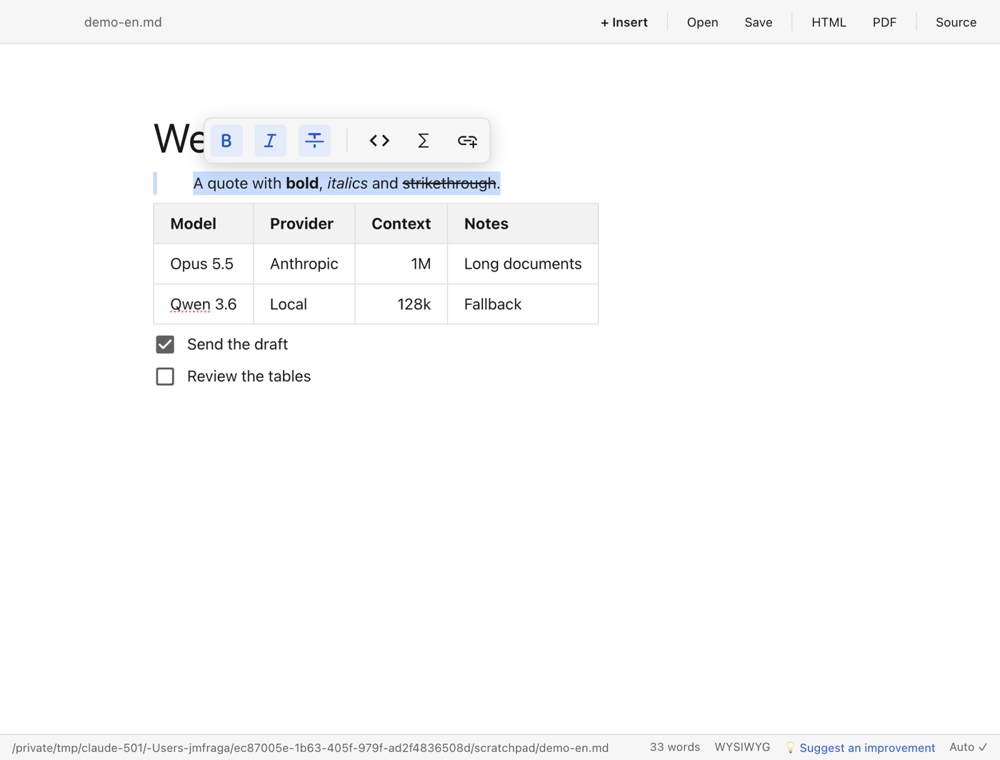
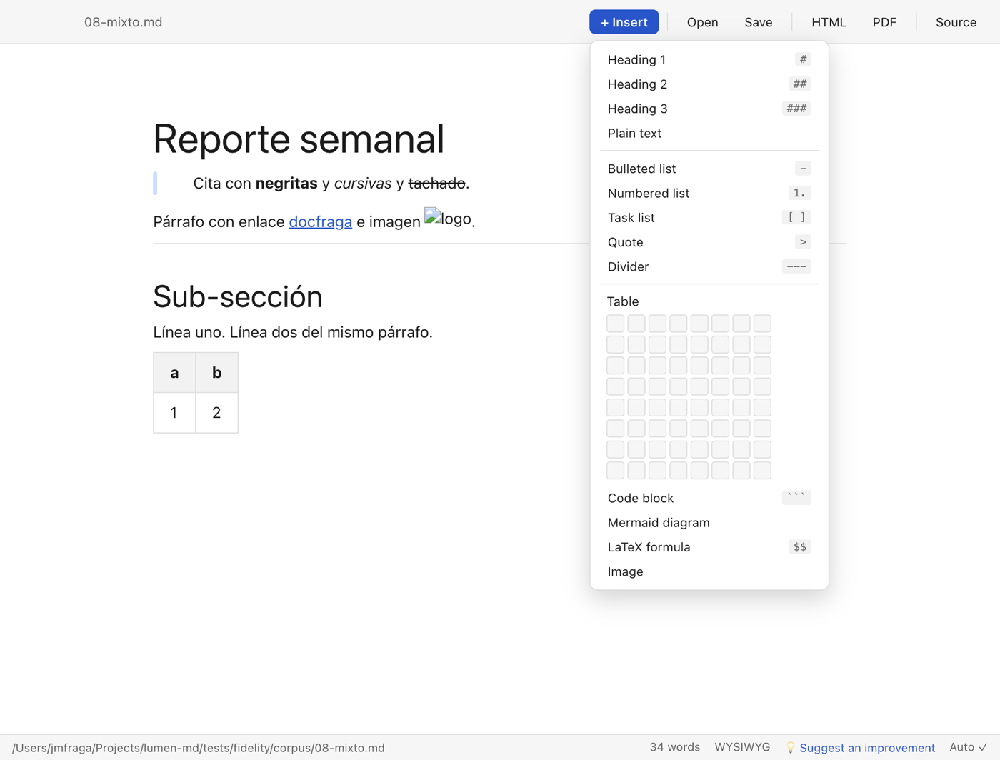
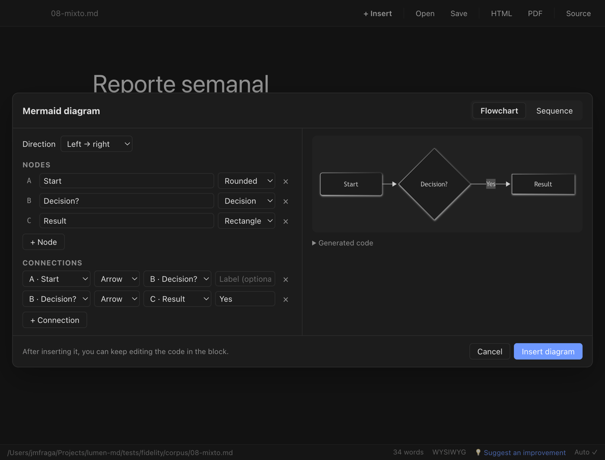

[Español](README.md) · **English**

# Lumen

**A Markdown reader and editor that doesn't break your tables.** Free, no account, no cost, for macOS, Windows, and Linux.

Lumen was built to comfortably review the `.md` files that ChatGPT, Claude, Gemini, and friends produce: they open with a double-click and look like a finished document (tables, syntax-highlighted code, diagrams, formulas), you can edit them without knowing Markdown, and they save back as clean Markdown.

The interface is available in **English and Spanish**. Lumen follows your system language and you can switch it anytime in **View → Idioma · Language**.



## Download

Latest version: **[Releases → latest](https://github.com/jmfraga/lumen-md/releases/latest)**

| Your computer                    | File to download                                        | Notes                                                            |
| -------------------------------- | ------------------------------------------------------- | ---------------------------------------------------------------- |
| **Mac** (Intel or Apple Silicon) | `lumen-md-x.y.z.dmg`                                    | Universal. Signed and notarized by Apple: opens with no warning. |
| **Windows** 10/11                | `lumen-md-x.y.z-setup.exe`                              | Installer. See the SmartScreen note below.                       |
| **Linux**                        | `lumen-md-x.y.z.AppImage` or `lumen-md_x.y.z_amd64.deb` | AppImage works on any distro; `.deb` for Ubuntu/Debian.          |

## Install

### Mac

1. Open the downloaded `.dmg`.
2. Drag **Lumen** into the **Applications** folder.
3. Open Lumen from Applications or Spotlight. The first time, macOS may ask whether you want to open an app downloaded from the internet: confirm. You won't see the "unidentified developer" warning because the app is signed and notarized.
4. To open all your `.md` files with Lumen: right-click any `.md` file → **Get Info** → **Open with** → Lumen → **Change All…**

### Windows

1. Run `lumen-md-x.y.z-setup.exe`.
2. Windows SmartScreen may show "Windows protected your PC" because the installer doesn't have a Windows code-signing certificate (that's a separate cost; the code is open and you can review it here). Click **More info** → **Run anyway**.
3. Follow the installer. You can choose the install folder.
4. To open `.md` files with a double-click: right-click a `.md` file → **Open with** → **Choose another app** → Lumen → check **Always use this app**.

### Linux

**AppImage** (any distribution):

```bash
chmod +x lumen-md-x.y.z.AppImage
./lumen-md-x.y.z.AppImage
```

If your distro doesn't ship FUSE 2, install it (`sudo apt install libfuse2` on Ubuntu/Debian) or run it with `--appimage-extract-and-run`.

**Debian / Ubuntu**:

```bash
sudo apt install ./lumen-md_x.y.z_amd64.deb
```

It registers as an app for `text/markdown`, so double-click works.

### Language

Lumen starts in your system language: Spanish if your system is in Spanish, English otherwise. To change it, go to **View → Idioma · Language** and pick **English** or **Español**. The switch is instant, doesn't restart the app, and never touches your open document. The menu name is bilingual on purpose, so anyone can find it.

### Updates

Lumen checks for a new version when it starts and once a day. When there is one, a bar appears above your document:

1. **Download**: fetches the update in the background while you keep working.
2. **Restart now**: saves your document, installs, and reopens Lumen. If you choose **When I quit**, it installs the next time you quit the app.

It never downloads or installs anything without asking. You can check manually in **Lumen → Check for Updates…** (Mac) or **Help → Check for Updates…** (Windows and Linux), and turn off automatic checks in the Help menu.

On Linux, the AppImage updates itself; with the `.deb`, Lumen lets you know and takes you to the downloads page.

If you have a version older than 0.3.0, download the latest one once from the link above; from then on, Lumen will let you know about new versions.

## Suggest improvements and report problems

Ideas and problems live in the [repository issues](https://github.com/jmfraga/lumen-md/issues), where everyone can see them, comment, and vote with 👍. New versions come from there.

- From the app: the **💡 Suggest an improvement** button in the bottom bar, or **Help → Suggest an Improvement… / Report a Problem…**. GitHub opens with an English form and your version and system already filled in.
- From the browser: [suggest an improvement](https://github.com/jmfraga/lumen-md/issues/new?template=improvement.yml) or [report a problem](https://github.com/jmfraga/lumen-md/issues/new?template=bug-report.yml).

You need a free GitHub account. No programming required: describe it the way you'd tell a friend.

## What it's for

- **Reviewing what the AI gave you.** You ask ChatGPT or Claude for a report, a plan, or an analysis, it hands you a `.md`, you double-click it and read it as a document: the comparison table looks like a table, not a row of vertical bars.
- **Fixing things without fighting the syntax.** Change a cell, tick a checkbox, fix a heading. Save, and it's still clean Markdown you can hand back to the AI or push to GitHub.
- **Sharing with people who don't read Markdown.** Export to **PDF** to send by email, or to a self-contained **HTML** file (a single page with everything inside) to share.
- **Documenting with diagrams without learning Mermaid.** The assistant asks for nodes and connections, or participants and messages, shows a live preview, and writes the code for you. You can keep editing it afterward.
- **Notes with images that travel with the document.** Paste a screenshot from the clipboard and Lumen saves it in an `assets/` folder next to the `.md`, with a relative path. Move the folder and everything still works.
- **Reading AI memory files, Obsidian notes, and files with frontmatter.** The YAML block at the top shows as a collapsible header and is preserved byte for byte when you save. `[[wikilinks]]` don't break.
- **Papers and scientific content.** Inline and block LaTeX formulas, rendered with KaTeX.

## Features

- **WYSIWYG** with [Milkdown](https://milkdown.dev): you type and see the result; tables are edited as tables.
- **Source view** (`Cmd/Ctrl+/`) with CodeMirror to see and fix the raw Markdown when you need to.
- **"+ Insert" button** (or type `/` on an empty line): headings, lists, quote, divider, table with a rows-and-columns picker, code, Mermaid diagram, formula, and image.

  

- **Mermaid diagram assistant** (flowchart and sequence) with live preview.

  

- **GFM tables, task lists, syntax-highlighted code, Mermaid, KaTeX, YAML frontmatter**.
- **Images** from the clipboard or from a file, copied to `assets/` next to the `.md`.
- **Double-click** a `.md` to open it; one window per document; drag and drop; recent files menu.
- **Autosave** (turn it off in the File menu). A warning on close if there are unsaved changes.
- **Export to self-contained HTML** and **to PDF** (`Cmd/Ctrl+P`).
- **English and Spanish** interface, switchable at any time.
- Light and dark theme following your system.

## Shortcuts

| Action                 | Mac                  | Windows / Linux           |
| ---------------------- | -------------------- | ------------------------- |
| New document           | `⌘N`                 | `Ctrl+N`                  |
| Open                   | `⌘O`                 | `Ctrl+O`                  |
| Save / Save As         | `⌘S` / `⇧⌘S`         | `Ctrl+S` / `Ctrl+Shift+S` |
| Toggle Markdown source | `⌘/`                 | `Ctrl+/`                  |
| Export to PDF          | `⌘P`                 | `Ctrl+P`                  |
| Block menu             | `/` on an empty line | `/` on an empty line      |

## FAQ

**Does it modify my file when I open it?** No. It only writes when you edit (autosave) or save. A test corpus checks that opening and saving without changes returns the same Markdown.

**Where do pasted images go?** Into an `assets/` folder next to the `.md`. The document needs to be saved first so Lumen knows where "next to" is.

**Does it send anything to the internet?** No. Everything runs on your computer. The only network requests are external image URLs in your document and the daily update check against GitHub, which you can turn off in the Help menu.

**Can I use it with Obsidian?** Yes: it opens the same `.md` files; frontmatter and `[[wikilinks]]` are preserved.

**I found a document that Lumen changes when saving.** That's a bug. [Report it](https://github.com/jmfraga/lumen-md/issues/new?template=bug-report.yml) with the original snippet and we'll add it to the fidelity corpus.

**How do I know which version I have?** **Lumen → About Lumen** on Mac, or **Help → What's New in This Version**.

## Development

```bash
npm install
npm run dev        # app with hot reload
npm test           # vitest: round-trip fidelity + unit tests
npm run typecheck
npm run size       # size budget (also enforced in CI)
npm run build:mac  # or build:win / build:linux
```

Requires Node 22+. Stack: Electron, React, TypeScript, Milkdown (ProseMirror), CodeMirror 6, Mermaid, KaTeX, unified/remark for export.

Lumen is intentionally lightweight. Every new feature has to earn its place: nothing at startup that can wait, and the size budget in CI isn't raised without a written reason.

### Translations

Interface text lives in `src/shared/i18n.ts`, in two plain dictionaries with no translation library. The English dictionary is typed so that a missing key fails the typecheck, and `tests/i18n.test.ts` checks that placeholders match between languages, that the English is consistently American, and that no hand-written Spanish text is left in the interface. To add a phrase, add it to both dictionaries.

### Markdown fidelity

`tests/fidelity/corpus/` contains representative documents. Each one goes through
open → serialize and must come back identical except for trivial normalizations.
Accepted differences are documented in `tests/fidelity/ALLOWED.md`.
If you have a `.md` that Lumen changes when saving, add it to the corpus in a PR.

### Signing and notarization (macOS)

The release workflow signs and notarizes **only if** these secrets exist on GitHub
(Settings → Secrets → Actions). They never go in the repo.

| Secret                        | Contents                                                          |
| ----------------------------- | ----------------------------------------------------------------- |
| `CSC_LINK`                    | _Developer ID Application_ certificate as a base64-encoded `.p12` |
| `CSC_KEY_PASSWORD`            | Password for the `.p12`                                           |
| `APPLE_ID`                    | Apple ID of the developer account                                 |
| `APPLE_APP_SPECIFIC_PASSWORD` | App-specific password (appleid.apple.com)                         |
| `APPLE_TEAM_ID`               | Team ID (10 characters)                                           |

Without them, the macOS build is unsigned: open it the first time with right-click → Open.

### Publishing a version

```bash
npm version patch   # or minor / major
git push --follow-tags
```

The `v*` tag triggers `release.yml`, which builds all three platforms and publishes the release (it stays as a draft until published by hand).

## License

MIT. See [LICENSE](LICENSE). Made by [Juan Manuel Fraga](https://docfraga.com) with help from Claude.
